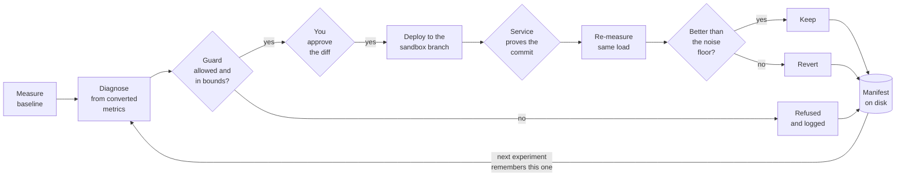
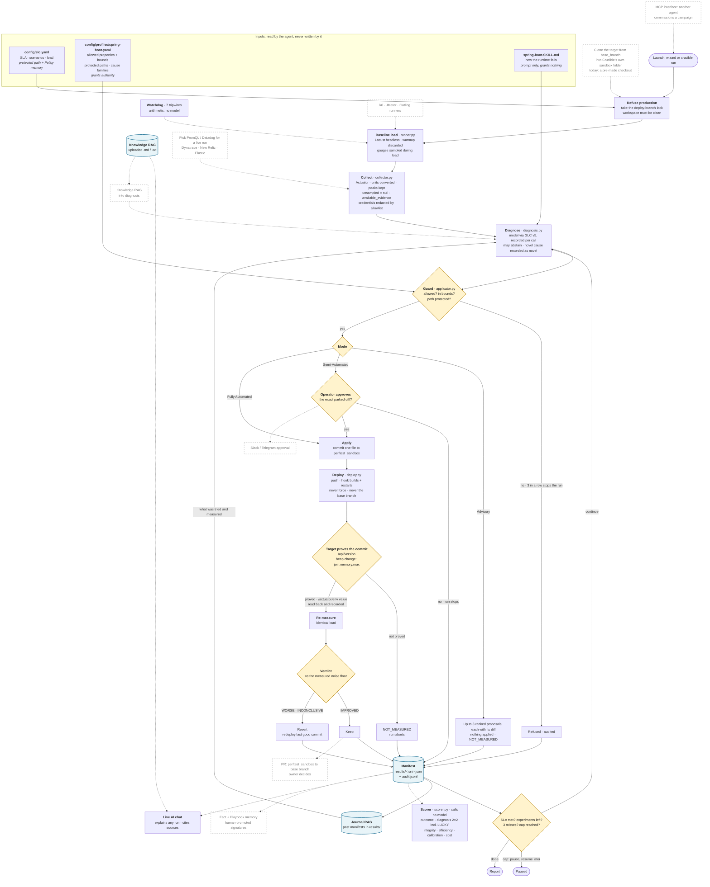

<div align="center">

# Crucible

### An autonomous performance engineer that proves every fix with a measurement

[](https://github.com/rraghu214/crucible/actions/workflows/ci.yml)


[How it works](#how-it-works) · [Results](#results) · [Quick start](#quick-start) · [Safety](#safety-rails) · [Docs](#documentation)

</div>

---

Your service misses its latency goal. Crucible **load-tests it, reads its telemetry,
names the cause, and proposes one bounded configuration change**. It waits for your
approval, deploys the change, waits until the service proves the change is running,
**measures again under the identical load**, and keeps the change only if the numbers
say it helped. Otherwise it reverts.

No guesswork reported as a fix, no dashboards to stitch together, and no agent that can
quietly move its own goalpost.

<table>
<tr><td>

**One real run** (2 November 2026, approved from the dashboard)

| | |
|---|---|
| Goal | p99 ≤ 120 ms on `/api/db`, 100 users |
| Measured before | **2500 ms** |
| Diagnosis | connection pool exhausted: 2 of 2 busy, requests queuing |
| Change proposed | `maximum-pool-size` 2 → 50 |
| Approved by | the operator, on the exact diff |
| Proof before measuring | the service reported the commit Crucible pushed |
| Measured after | **69 ms**, kept |

</td></tr>
</table>

---

## How it works



Every experiment ends as a JSON manifest: what was measured, what the agent thought,
what it changed, who approved it, which commit ran, what was measured after, which model
answered, and the verdict. The dashboard, the chat and the scorer all read those files.

**Four ways to run it**

| Mode | What happens | Who decides |
|---|---|---|
| **Advisory** | Diagnoses and returns up to three ranked changes, each with its exact diff. Applies nothing. | You, by hand |
| **Semi-Automated** | Each change waits for your approval of that exact diff. | You approve, Crucible executes |
| **Fully Automated** | No prompts. The guard, the bounds and the measured verdict still decide. | Crucible, inside your bounds |
| **Ceiling probe** | Raises the load in steps until the goal is first missed. Changes no setting. | You set the limits |

<details>
<summary><b>The full flow: what is built today, and what is planned (dashed)</b></summary>

<br/>

One campaign as the code runs it (`crucible/perf/campaign.py`), checked against the code
on 3 November 2026. Solid boxes are built and used in the demo; dashed boxes are
designed, not built.



**Also built, off the main loop:** scenarios run in series (`--all-scenarios`), each with
its own baseline; hooks (`before_each`, `after_each`, `on_abort`); mid-run edits by the
operator, taken at the next experiment boundary and recorded as amendments; cost and
wall-clock caps that pause rather than stop; Jaeger traces through `--jaeger-url`;
snapshot capture from Actuator, PromQL and Datadog in one load window.

Where each dashed item is recorded: [`docs/ref/DEBT.md`](docs/ref/DEBT.md) and
`DESIGN.md` §5 and §16.

</details>

---

## Results

Crucible tests its own agent in two ways, both starting from **fixtures**: PerfLab
deliberately put into a known state, with the right answer written down before any run.

| | **Replay**: can it diagnose? | **Live**: does its fix work, for the right reason? |
|---|---|---|
| What runs | The model reads a frozen measurement. Nothing is deployed. | The whole loop on the real service, change measured. |
| Graded results | **40 cases** (18 tasks over 23 snapshots of 19 fixtures) | **8 experiments** in 6 campaigns, one fault each |
| Score | Right cause in **31 of 37** cases that have one · task grade **32 of 40** | **7 CORRECT, 1 LUCKY**, 0 UNLUCKY, 0 WRONG · every goal met |
| Cost | $0.054 | $0.0115 |

**48 graded results in all.** Run 2, 1 November 2026, model `gemini-3.5-flash-lite`,
blinded: the model never saw the fault's name.

**Why "LUCKY" matters.** On the N+1 query fault the agent first raised the connection
pool. p99 fell 11%, so an outcome-only score calls it a success. Crucible's scorer marks
it LUCKY: the diagnosis was wrong. The next experiment fixed the real cause. Scoring
understanding separately from outcome is what catches an agent that is right by accident.

Weak spots, stated: one pass rather than three repeats, and the "nothing is wrong" and
"ambiguous evidence" task classes score 2/5 and 1/2. Full write-ups:
[replay](docs/BENCHMARK_REPLAY_RESULTS.md) · [live](docs/BENCHMARK_LIVE_RESULTS.md) ·
[method](EVALUATION.md).

---

## Quick start

You need Python 3.11+, [uv](https://docs.astral.sh/uv/), a service exposing Spring Boot
Actuator, and a model gateway (`GLC_BASE_URL`). Crucible holds no model keys itself.

```bash
uv sync --group load                 # Locust comes with the 'load' group
cp .env.example .env                 # set GLC_BASE_URL and CRUCIBLE_CONTROL_TOKEN

uv run crucible serve                # dashboard at http://127.0.0.1:8113/dashboard

uv run crucible plan                 # what a campaign would change, and where. Touches nothing.
uv run crucible preflight            # checks the target once: reachable, metrics readable, commit reported
uv run crucible run --all-scenarios  # a real campaign; each proposal waits for approval
uv run crucible approve <run-id> --experiment 1 --as <you>
```

Every dashboard button runs the same function as its CLI command, through the same
guard. Step-by-step setup, including a two-box deployment: [Getting started](docs/GETTING_STARTED.md).

---

## What it plugs into

| | Built and used | Built, partly wired | Planned |
|---|---|---|---|
| **Metrics** | Spring Boot Actuator | PromQL, Datadog (snapshot capture; live use planned) | Dynatrace, New Relic, Elastic |
| **Traces** | | Jaeger (`--jaeger-url`) | Tempo, Datadog APM |
| **Load** | Locust | | k6, JMeter, Gatling |
| **Runtime** | Spring Boot | FastAPI profile drafted | Express, .NET |
| **Deploy** | git push to a sandbox branch + post-receive hook | | the same push into Jenkins / GitHub Actions |
| **Model** | any model behind the GLC v5 gateway | | direct providers |

PromQL is one adapter for Prometheus, Mimir, Thanos, VictoriaMetrics, Grafana Cloud and the
cloud-managed Prometheus services.

---

## Safety rails

- **It can only change what you list.** The target profile names each tunable property
  and its bounds. A proposal outside them is refused before it reaches the service.
  `SKILL.md` teaches the model how the runtime fails; it grants nothing.
- **It cannot move its goalpost.** The SLA and the load profile are protected files, and the
  SLA is also stored as Policy memory the agent has no permission to write.
- **It cannot run anything it likes.** No shell, an allowlist of programs, the workspace
  only, a timeout. `git push` and `git -c …` are refused.
- **It never touches production or your main branch.** A production environment is
  refused at start; writes go to `perftest_sandbox` only, never force-pushed.
- **A fix is not a fix until it is measured.** No measurement until the service reports the
  pushed commit; the verdict uses measurements, never the model's prediction.
- **Credentials never reach the model.** Configuration is redacted by allowlist before
  anything is stored or sent.

The full reasoning behind each rule, and the failure that produced it: [`DESIGN.md`](DESIGN.md).

---

## Repository map

```text
crucible/perf/        the product: campaign loop, collector, diagnosis, guard, deploy, scorer, replay
crucible/ui/          the dashboard (client/crucible-ui.html) and the screens it reads
crucible/             the rest is the S17Code agent harness Crucible is built on
config/               slo.yaml (the goal), profiles/ (authority), tasks/ and fixtures/ (the benchmark)
fixtures/             the 23 frozen snapshots replay runs against
locust/locustfile.py  the built-in load script
scripts/              Box A deploy hook, Box B restart script, snapshot capture, noise sampling
tests/                1993 tests;  tests_security/ the security review's own suite
docs/                 guides, results and design evidence (start at docs/README.md)
```

## Documentation

| Read this | For |
|---|---|
| [Getting started](docs/GETTING_STARTED.md) | Install, run locally, run on a two-box setup |
| [DESIGN.md](DESIGN.md) | Every design decision, and why |
| [EVALUATION.md](EVALUATION.md) | How the benchmark is built and scored |
| [docs/README.md](docs/README.md) | The index of everything else |

Built on the S17Code agent harness from the EAG V3 course. The service under test is a
separate repository, [perf-lab](https://github.com/rraghu214/perf-lab). MIT licence.
