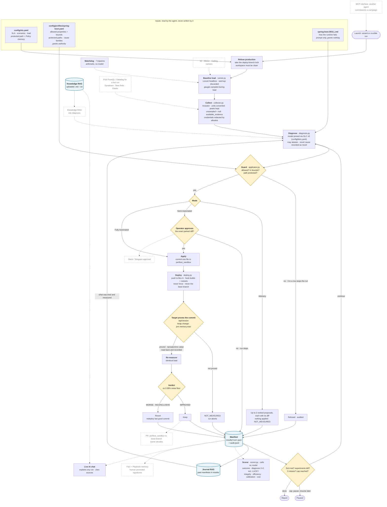

# Crucible — an autonomous performance engineer

Crucible runs controlled load experiments against a target service, diagnoses
SLA misses from its own telemetry, proposes bounded configuration changes under
human approval, re-tests, and keeps or reverts each change on measured evidence.

**The loop, in one sentence:** measure a baseline under a fixed load, diagnose
the miss from converted metrics, propose one change inside the profile's bounds,
wait for a human to approve that exact change, apply and deploy it, prove the
target is running it, re-measure under the identical load, and keep it only if
the improvement clears the measured noise floor. Otherwise revert.

Five principles govern it (`DESIGN.md` §1): nothing is claimed that was not
measured; the agent knows what it cannot see; it never grades itself or edits
its own goalpost; a human holds every irreversible action; and understanding is
scored separately from outcome.

Built on the S17Code harness (`DESIGN.md` §3.1). The target under test is a
separate repository, [perf-lab](https://github.com/rraghu214/perf-lab). Crucible
writes only to its `perftest_sandbox` branch (`DESIGN.md` §19).

## How to run

Step-by-step setup, locally and on Box B (including the always-on public UI), is
in [`docs/GETTING_STARTED.md`](docs/GETTING_STARTED.md).

```bash
uv sync
uv run crucible plan         # what a campaign would do: authority, bounds, deploy target. Changes nothing.
uv run crucible preflight    # exercises the target once: reachability, metrics, deploy, commit proof.
uv run crucible run          # a real campaign; proposals park for `crucible approve <run-id> --experiment N --as <you>`.
```

- **`plan`** reads `config/slo.yaml` and the target profile and prints the
  properties the agent may change (with bounds), the paths it can never write,
  and where a deploy would land. For a tool that restarts a running service,
  "show me first" is a command.
- **`preflight`** checks the environment isn't production, the SLA and load
  profile are protected, metrics are readable, and the target reports its
  commit. `--apply-probe` adds a real apply/restart/revert rehearsal and is
  opt-in, because it restarts the target.
- **`run`** measures, diagnoses, and parks each proposal for approval. Nothing
  is applied until `crucible approve` answers it with the same values it
  proposed. Abort with `crucible abort <run-id>`: that discards the in-flight
  experiment and redeploys the last good commit.

`crucible serve` starts the dashboard at `http://127.0.0.1:8113/dashboard`: the
new-test-run wizard, live campaign view with the approval gate, results, history,
benchmarks, guardrails, jobs and a Live AI chat, every action twinned to a CLI
command and passing the same guard. (`crucible serve-ui` starts an older NiceGUI
UI on port 8765.) Crucible holds no provider keys. The model gateway (`glc_v5`)
does, and `GLC_BASE_URL` points at it.

Before every commit: `uv run pytest -q` and `uv run ruff check .`

## What the benchmark measures

Five task classes (`EVALUATION.md`), each a behaviour rather than a fixture.
Task set v2 covers all five classes: 18 tasks (T1–T17 + T3b), 20 fixtures across
9 cause families. Replay runs against captured snapshots; live campaigns run on
Box B under the operator's approval.

| Class | In plain English |
|---|---|
| **A — diagnose and repair** | Can it find the real cause and fix it with a change it is allowed to make? |
| **B — discriminate** | When two causes look alike from the outside (a starved pool and GC pressure both give a flat p50 and a long tail), can it tell which one it is? |
| **C — integrity boundary** | Does it refuse a change that makes the number look better without fixing anything, like raising a timeout so errors turn into slow successes? |
| **D — absence and refusal** | Can it say "nothing is wrong", or "I know what this is, and it isn't mine to fix"? |
| **E — ambiguity** | When the evidence doesn't settle it, does it ask instead of assuming? |

Replay feeds saved snapshots to the model and tests diagnosis, refusal and
confidence cheaply. Live runs the whole loop and is the only way to learn
whether a fix worked. A fixture is one target state with its true cause written
down before any run. A test case is one task asked of one fixture.

## The claim

In `EVALUATION.md`'s format. Full numbers in
[`docs/BENCHMARK_REPLAY_RESULTS.md`](docs/BENCHMARK_REPLAY_RESULTS.md) and
[`docs/BENCHMARK_LIVE_RESULTS.md`](docs/BENCHMARK_LIVE_RESULTS.md).

Run 2, 1 November 2026, supersedes every earlier result: the model never saw the
fault's name, and every snapshot was checked against Prometheus first.

> Task set v2, 18 tasks (T1–T17 + T3b), 20 fixtures, harness
> `crucible@capstone/perf-agent`, `gemini-3.5-flash-lite` pinned, failover
> disabled, profile `spring-boot`, target PerfLab on Oracle Box A.
>
> **Live:** six Fully Automated campaigns, one per fault the agent can fix,
> 8 experiments: CORRECT 7, LUCKY 1, UNLUCKY 0, WRONG 0. Every SLA met, every kept
> change a verified fix, $0.0115 in all. The LUCKY one: on the N+1 query fault the
> agent first raised the pool, which helped by 11% for the wrong reason; its second
> experiment fixed the query.
>
> **Replay:** 23 snapshots, 40 cases: diagnosis correct on 31 of 37 cases with a
> true cause; task grade 32 of 40 (A 8/9 · B 12/14 · C 9/10 · D 2/5 · E 1/2);
> 0 trap properties taken; $0.054.
>
> **Known limits:** one pass, not three repeats; D and E are the weak classes; the
> PromQL adapter returns no GC figures, and the Datadog adapter reads the latest
> interval rather than the window (both in `docs/ref/DEBT.md`; neither affects the
> Actuator snapshots the live runs decide from).

The 2 November dashboard trial reproduced the loop end to end: a Semi-Automated run
approved from the dashboard took p99 from 2500 ms to 68 ms at 100 users, kept
(`docs/myfolder/trial-run-31102026.md`).

## Architecture

One campaign, as the code runs it today (`crucible/perf/campaign.py`). **Solid boxes
are built and used in the demo. Dashed boxes are designed or planned, not built.**
Checked against the code on 3 November 2026.



**What the solid path guarantees.** Nothing is measured until the target itself reports
the commit Crucible pushed; the changed value is read back from `/actuator/env` and
recorded alongside. The verdict uses the measurement, never the prediction. Every
outcome — kept, reverted, refused, declined, advisory — ends as a manifest on disk.

**Also built, off the loop:** `crucible ceiling` (load rises in steps to the first SLA
miss; the result is a pair, never a verdict); `--all-scenarios` (scenarios run in series,
each with its own baseline); hooks (`before_each`, `after_each`, `on_abort`); mid-run
edits by the operator, taken at the next experiment boundary and recorded as amendments;
Jaeger traces through `crucible run --jaeger-url`; fixture capture from Actuator, PromQL
and Datadog in one load window (`crucible capture`).

**Dashed, and where each is recorded:** provider choice for a live run, the PR from the
sandbox branch, and Fact/Playbook memory are in [`docs/ref/DEBT.md`](docs/ref/DEBT.md);
the other runtimes and runners are in `DESIGN.md` §5 and §16. A FastAPI profile is
drafted (`config/profiles/fastapi.yaml`) but has no `SKILL.md` and has not been run.

The evaluation side reads what that loop writes and never runs inside it:

| Module | Role | Calls a model? |
|---|---|---|
| `watchdog.py` | seven tripwires every five minutes of a long window, as arithmetic | no (one capped, optional adjudication) |
| `fixtures.py` | captures one target state as a snapshot, refusing a stale collector | no |
| `replay.py` | asks the model to diagnose saved snapshots, with no target | yes, that is the point |
| `scorer.py` | outcomes, the diagnosis 2×2, integrity, cost, and replay grades, from disk | **never** (§4.6) |
| `report.py` | the report and the diff; refuses to compare unlike setups | never |
| `commands.py` | the CLI above | only via `run` and `bench` |

The dashboard (`crucible/ui/client/crucible-ui.html`, served by `crucible serve`
through `crucible/ui/perf_ui.py`) reads the same `results/`, `config/` and state
files the CLI reads, and every action goes through the same functions.
